# MGLSK UI

A terminal-styled UI kit for web apps: **68 components**, an app shell, SVG charts and WebGL effects, in plain HTML, CSS and
vanilla JavaScript. No framework, no runtime dependencies. A build step is optional.

```
dist/css/mglsk-ui.min.css    102 kB   (19.8 kB gzip)
dist/js/mglsk-ui.min.js       81 kB   (27.5 kB gzip)   icons + theme + behaviour + charts + forms + overlays + display + a11y + effects
dist/fonts, dist/img        self-hosted woff2 fonts and the logo
```

## Screenshots

Dark mode with the default green accent, unless noted. Light mode and every accent come from the same CSS (see
[theming](components/theming.html)).

| | |
|---|---|
| 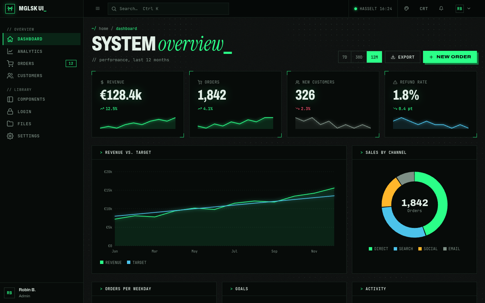<br>**Dashboard** (`examples/dashboard.html`) | 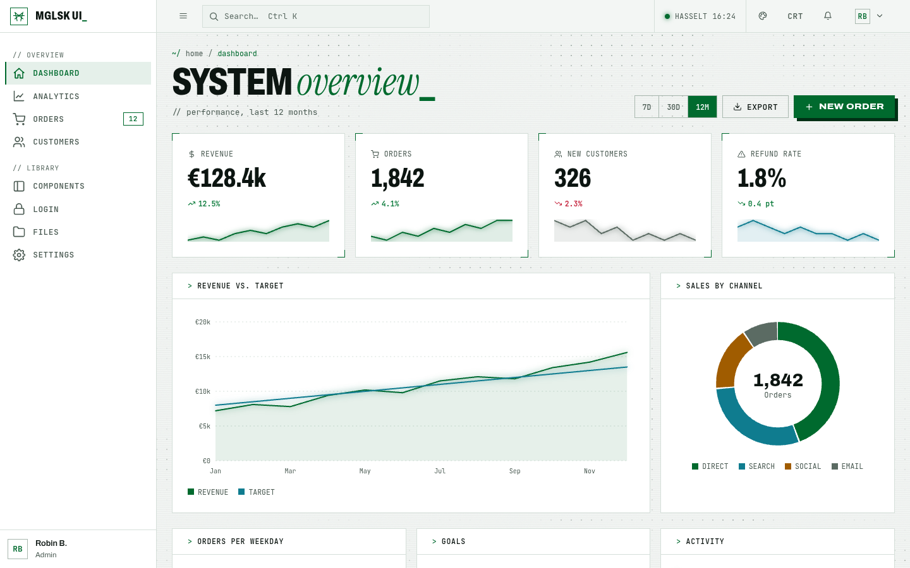<br>**Light mode** |
| 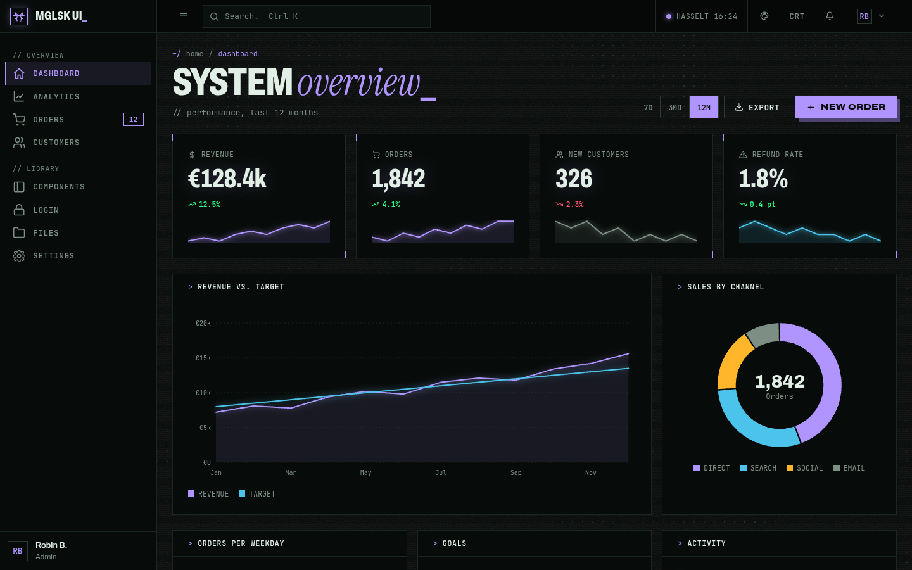<br>**Violet accent** | 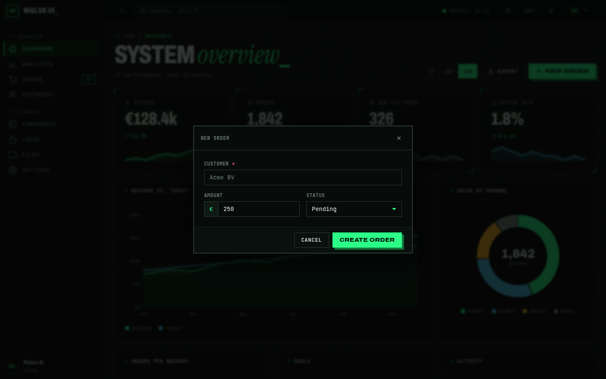<br>**Dialog** |
| 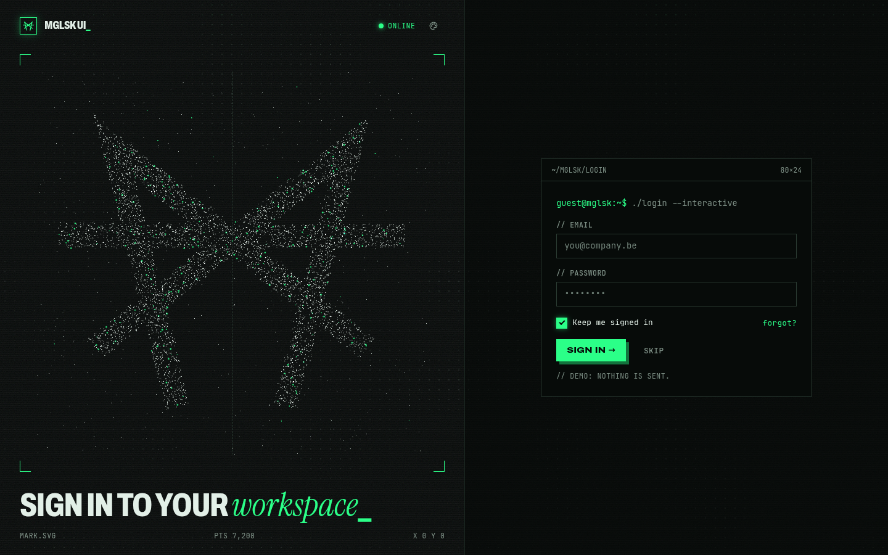<br>**Login** with the WebGL particle logo | 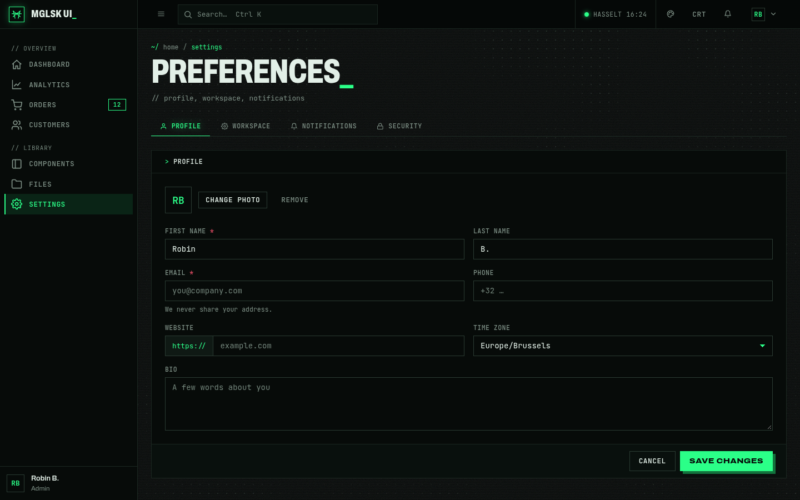<br>**Settings** (tabs, fields, input groups) |

### Components

| | |
|---|---|
| 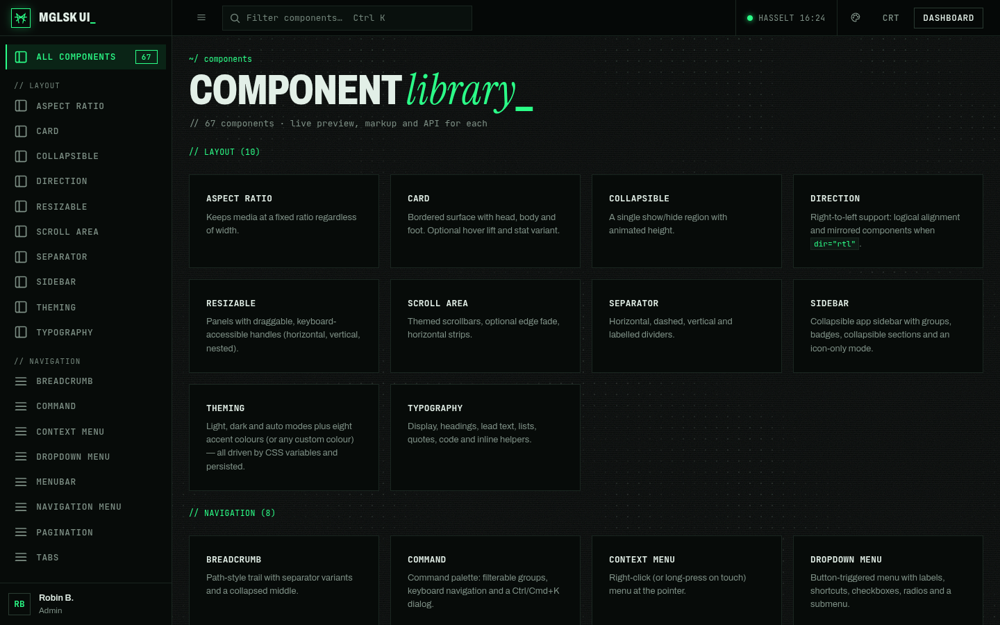<br>**Component library** | 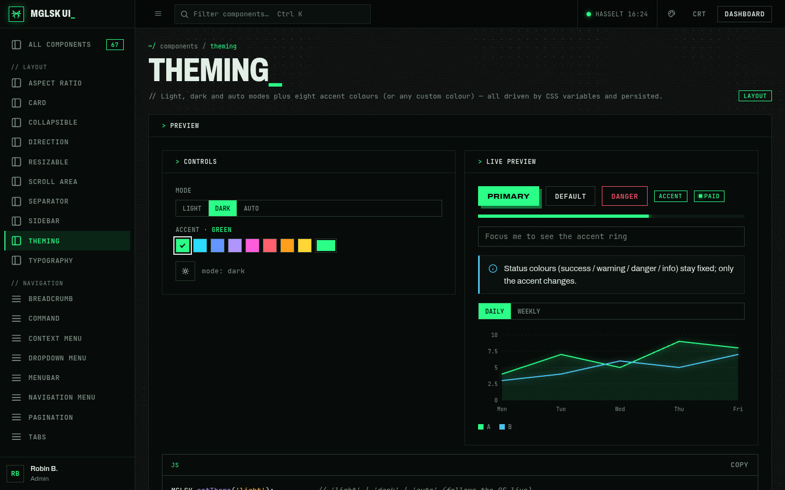<br>**Theming** (mode + 8 accents) |
| 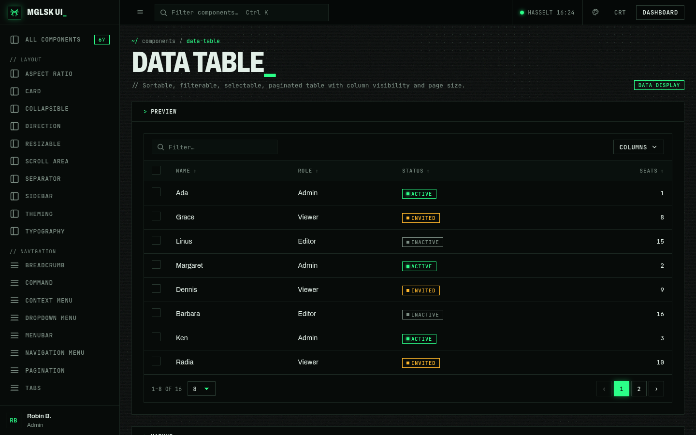<br>**Data table** | 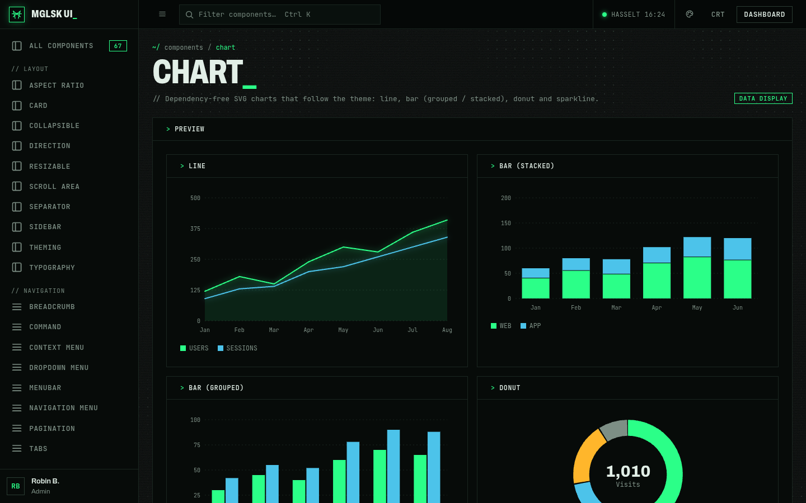<br>**Charts** |
| 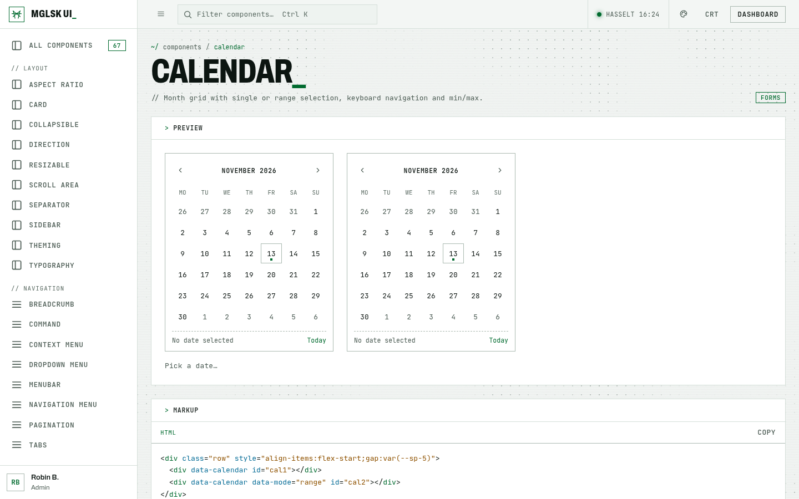<br>**Calendar** (light) | 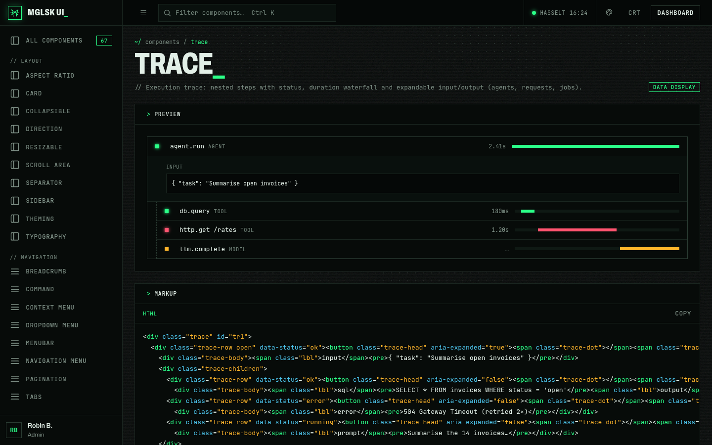<br>**Trace** |
| 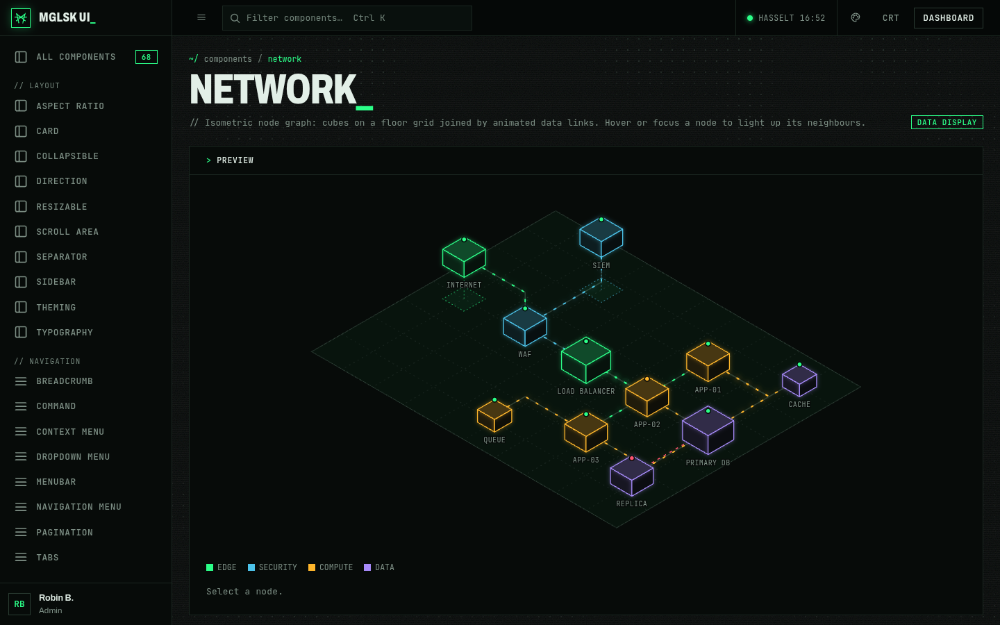<br>**Network**: isometric node graph | 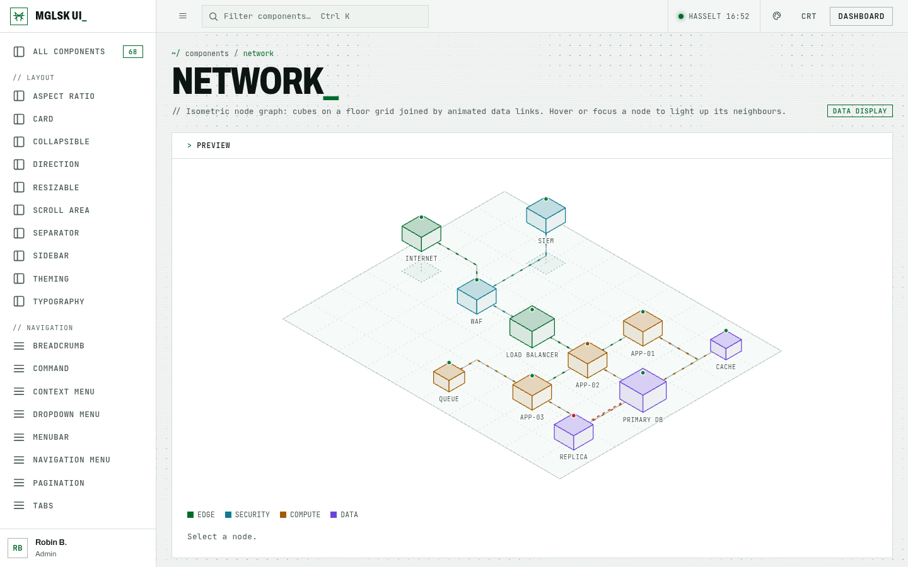<br>**Network** (light) |

Regenerate them with `npm run screenshots` (needs Chromium; set `CHROMIUM=/path/to/chrome` if it is not at `/usr/bin/chromium`).

## Quick start

1. Copy `starter/` (it carries its own `assets/`), or copy `dist/` into your project.
2. Link the two files:

```html
<link rel="stylesheet" href="assets/css/mglsk-ui.min.css">
<script src="assets/js/mglsk-ui.min.js"></script>   <!-- end of <body> -->
```

3. Use the markup from the component pages. Open `components/index.html` (live preview, copyable markup and an API table for
   every component) or `examples/dashboard.html`.

Fonts are referenced as `../fonts/…` from the stylesheet, so keep `css/` and `fonts/` as siblings.

## Install from npm (private package)

`@mglsk/ui` is published as a **private** npm package. Authenticate once (`npm login`, or a token with read access in `~/.npmrc`),
then:

```bash
npm install @mglsk/ui
```

```js
import '@mglsk/ui/css';   // dist/css/mglsk-ui.min.css
import '@mglsk/ui';       // dist/js/mglsk-ui.min.js (defines window.MGLSK)
```

Releases are built, verified and published by GitHub Actions; see [`RELEASING.md`](RELEASING.md).

## How it works

- **CSS-first.** Components are classes (`.btn`, `.card`, `.table`…). Most work with no JS at all.
- **Declarative JS.** Behaviour attaches through `data-` attributes (`data-modal-open`, `[data-select]`, `[data-tabs]`,
  `[data-calendar]`…) and initialises on load. After injecting markup, call `MGLSK.init(root)`.
- **Icons:** `<i data-icon="home"></i>` becomes an inline SVG. Add your own to `MGLSK.icons`.
- **Events:** custom events such as `mglsk:calendar`, `mglsk:otp`, `mglsk:page`, `mglsk:command`, `mglsk:toggle` bubble from
  the component.

### JS API (excerpt)

| Call | Purpose |
|------|---------|
| `MGLSK.toast({ title, message, type, timeout, action })` | Toast notification |
| `MGLSK.confirm({ title, message, confirmText, danger })` | Promise-based confirm dialog |
| `MGLSK.charts.line / bar / donut / spark(el, opts)` | SVG charts (re-render on resize, themed by `--s1…--s6`) |
| `MGLSK.charts.network(el, { nodes, links })` | Isometric node graph with animated data links; hover/focus lights up neighbours |
| `MGLSK.calendar(el, opts)`, `MGLSK.pagination(el, opts)` | Programmatic calendar / pagination |
| `MGLSK.paginate(table, perPage, pager)` | Table pagination; returns `{ draw, setPerPage }` |
| `MGLSK.scroller(el)` | Chat scroller: `append(node)`, `toEnd()` |
| `MGLSK.highlight(src, lang)` | Code highlighter (returns HTML) |
| `MGLSK.fx.particles(canvas, { text \| path, viewBox }, opts)` | WebGL particle logo |
| `MGLSK.init(root)` | Re-scan markup after DOM changes |

## Theming

**Mode and accent are runtime switches** (no rebuild): light, dark or auto (follows the OS live), and eight accent colours or any
custom colour. Everything is driven by CSS variables.

```js
MGLSK.setTheme('light');        // 'light' | 'dark' | 'auto'
MGLSK.setAccent('orange');      // green | cyan | blue | violet | magenta | red | orange | yellow
MGLSK.setAccent('#ff9f1c');     // any colour: lightened/darkened until it is >= 4.5:1 in both modes
```

Declarative controls need no JS: `[data-theme-set="light"]`, `[data-theme-toggle]`, `[data-accent-set="cyan"]`,
`input[type=color][data-accent-custom]`. The ready-made panel (mode + swatches + colour picker) is in every topbar and on
`components/theming.html`. Choices persist in `localStorage` (`mglsk-theme`, `mglsk-accent`).

**Avoid a flash of the wrong theme** by putting this in `<head>` before the stylesheet paints (every page here already has it):

```html
<script>(function(){try{var d=document.documentElement,l=localStorage,t=l.getItem('mglsk-theme')||'dark',a=l.getItem('mglsk-accent');d.dataset.theme=t;d.dataset.themeResolved=t==='light'||(t==='auto'&&matchMedia('(prefers-color-scheme: light)').matches)?'light':'dark';if(a){if(a.charAt(0)==='#'){var v=JSON.parse(l.getItem('mglsk-accent-vars')||'{}');for(var k in v)d.style.setProperty(k,v[k]);d.dataset.accent='custom'}else d.dataset.accent=a}if(l.getItem('mglsk-fx')==='off')d.dataset.fx='off'}catch(e){}})()</script>
```

**Tokens** live in `css/tokens.css`. Brand-level overrides go after the stylesheet:

```css
:root                              { --accent-d: 255 159 28; --accent-l: 160 80 0; }   /* default accent: dark-mode / light-mode "r g b" */
html[data-theme-resolved="light"]  { --bg: #faf7f2; }                                  /* tweak a neutral in one mode */
```

- Accent: `--accent-rgb` (current mode, use `rgb(var(--accent-rgb) / .2)` for tints), `--accent`, `--accent-soft`, `--accent-deep`,
  `--on-accent` (text colour that is readable on an accent fill).
- Neutrals: `--bg --surface --surface-2 --surface-3 --border --border-strong --text --muted --faint`.
- Status (fixed, independent of the accent): `--success --warning --danger --info` and `-soft` tints.
- Charts: `--s1` follows the accent, `--s2…--s6` are fixed per mode.
- The magenta glitch colour swaps to cyan when the accent is magenta/violet.

The WebGL dot field and particle logo read these tokens: neon glow on dark, ink-on-light in light mode. The contrast of every
accent in both modes is checked by `npm test` (all pairs >= 4.5:1).

Effects: add `data-fx="off"` on `<html>` to disable scanlines, grain and the WebGL field (the `[data-fx-toggle]` button does this
and remembers it). Add `data-no-field` anywhere on a page to keep scanlines but skip the dot field.
`prefers-reduced-motion` turns animation off and renders one static WebGL frame.

## Repository layout

```
css/        source stylesheets (mglsk-ui.css imports the rest)
js/         source modules (each is a self-contained IIFE); theme.js = mode/accent engine, a11y.js = cross-cutting ARIA/keyboard
fonts/ img/ assets; fonts/licenses has the OFL texts
dist/       built bundles (generated)
starter/    minimal app to copy; starter/assets is generated from dist
examples/   dashboard, settings, login (use the unbundled source)
components/ generated documentation, one page per component
tools/      build-dist.mjs, check-pack.mjs (release guard), docs generator (tools/docs), tests (tools/test)
.github/    CI + release workflows, dependabot
RELEASING.md  one-time setup and how to cut a release
```

## Develop

```bash
npm install            # esbuild only
npm run build:dist     # dist/ + starter/assets
npm run build:docs     # regenerate components/*.html (python3)
npm run build          # both
npm run check:pack     # what would be published (also runs before every publish)
npm test               # starter, theming + contrast matrix, 68-page error sweep, interactions, accessibility (axe + keyboard)
npm run test:a11y      # just the accessibility suites
```

Component demos, markup and API notes live in `tools/docs/comps*.py`; edit those, not the generated HTML.
Tests need Playwright and a Chromium (`CHROMIUM=/path/to/chromium npm test`).

## Browser support

Uses `<dialog>`, `:has()`, `color-mix()`, CSS `mask`, `scroll-snap` and WebGL 1. That means roughly Chrome/Edge 111+,
Safari 16.4+ and Firefox 121+. **Only Chromium has been tested so far.** Without WebGL the dot field is skipped and the particle
logo falls back to plain 2D dots.

## Accessibility

Built to WCAG 2.2 AA and checked on every `npm test`: **axe-core finds 0 violations** on 72 pages × both themes plus 16 open
states, and a 73-check keyboard/behaviour suite covers focus management, ARIA state, live regions, dismissible hover content,
pausable motion, 320 px reflow, text spacing, visible focus and forced colours. Skip link, landmarks, roving tabindex, focus
return, accessible names for custom selects/menus/calendars/charts, `prefers-reduced-motion`, `prefers-contrast` and
`forced-colors` support are built in.

**Not verified yet:** manual screen-reader testing (NVDA / JAWS / VoiceOver / TalkBack), Firefox and Safari, real touch and voice
devices. See [`ACCESSIBILITY.md`](ACCESSIBILITY.md) for the per-component keyboard map, the author checklist and the full list of
what is and isn't covered. Run it yourself: `npm run test:a11y`.

## Licence

**Proprietary: all rights reserved.** Copyright (c) 2026 MGLSK. The kit may not be used, copied, modified or shared without a
written agreement with MGLSK (see `LICENSE`). The package is marked `"private": true` / `"license": "UNLICENSED"`, so it cannot be
published to npm by accident.

The three bundled fonts are the exception: they are licensed to everyone under the SIL OFL 1.1 (`THIRD-PARTY.md`).

Note on what "closed source" can mean for a front-end kit: anything served to a browser (the CSS and JS in `dist/`, the HTML)
can be read by whoever loads the page. The licence protects the kit legally; minification only makes it harder to read, it does not
hide it. Source maps are not built or shipped unless you opt in (`SOURCEMAP=1`).
